# Vaccine Assay Pipeline

**One command takes a synthetic vaccine trial's plate-reader files and lab records through a mini-LIMS with an
append-only audit trail, 4PL standard curves, QC and dbt marts. It refuses plates that fail and reports how many of
13 planted problems it caught.**

> **All data is synthetic.** A seeded generator invents every subject, sample, plate and reading. No real trial,
> patient, lab or company data is used, and nothing here describes how any real lab works. This is a portfolio
> demonstration of GxP-style practice. It is **not a validated system** and makes no compliance claim.

## Results at a glance

| Result | Value | What is behind it |
|---|---|---|
| Planted problems caught | **13 of 13** | 14 of 14 affected records, 9 problem types: bad standards, swapped samples, missing custody step, late entry, control out of range, duplicate-well CV, tampered audit row, over-range samples, record edited by direct SQL |
| Samples with an unexplained flag | **1 of 360 (0.277%)** | SMP-00180, a second catch of the tampered audit row, left visible on purpose ([FLAW_HUNT FH-05](docs/FLAW_HUNT.md#fh-05-metric-gaming)); target ≤ 5% |
| Plates rejected without a planted cause | **0 of 13** | rejected: exactly PLATE-003 (control out of range) and PLATE-007 (fit and standard recovery) |
| pytest | **245 passed, 0 failed** | 356.12 s, 2026-10-30; includes the QA edge tests in `tests/qa/`, with every fixed bug's strict-xfail test switched on |
| dbt build | **145 of 145 passed** | 34 models, 111 data tests, 0 warnings |
| Same seed, run twice | **58 of 60 files byte-identical** | the DuckDB file and audit anchor differ only in run-clock columns: 30 of 37 tables identical, 7 clock-only, 0 other differences ([FLAW_HUNT FH-01](docs/FLAW_HUNT.md#fh-01-duplicates-or-drift-on-re-run-re-verified-2026-10-30)) |
| Reportable results | **358 of 360** | the 2 missing are the swapped pair, held back by design; 80 rows on the re-assay list |
| Synthetic Day 29 readout | **Vaccine GMT 4,332 vs Placebo 219 AU/mL** | Vaccine 95% CI 3,077-6,100, n = 58, seroresponse 56 of 58; Placebo n = 60, seroresponse 0 of 60 |

Read from [docs/results.json](docs/results.json) (seed 42, rule version QC-RULES-1.0) and the repeat-run evidence in
[docs/evidence/](docs/evidence/). Values are truncated, never rounded up. Synthetic data.

The block below is rewritten by `python -m pipeline.run` on every run, so it cannot drift from results.json:

<!-- results:start -->
| Result | Value |
|---|---|
| Samples / plates (rejected) | **360 / 13 (2)** |
| Reportable / missing results | **358 / 2** |
| Planted problems detected | **13 of 13 required planted problems caught (14 of 14 affected records); 0 of 0 optional** |
| Unexplained sample-flag rate | **0.277%** |
| Audit hash chain | **BROKEN (INJ-7 caught)** |
| dbt build | **145 of 145 passed**, 0 failed |
| pytest | **245 passed**, 0 failed (2026-10-30) |

Numbers from `python -m pipeline.run --seed 42`, stored in [docs/results.json](docs/results.json). Synthetic data only.
<!-- results:end -->

**Start here:** the [one-page summary](docs/EXECUTIVE_ONE_PAGER.md), or the [case study](docs/CASE_STUDY.md)
(the problem, what was built, what broke and how it was fixed).

## Interactive site

A seven-page static site built with Quarto and Observable Plot: **[site/](site/)** (open `site/_site/index.html`
after building, or publish to GitHub Pages with `quarto publish gh-pages site`). It is not published yet.

- **Overview (the production story):** a one-screen verdict ("On track", 56 of 58 vs 0 of 60, 13 of 13 caught,
  tamper detected at the exact row), then six short chapters: where lab testing sits in a real vaccine program
  (Prevnar 20's public FDA timeline as a labelled reference), antibody dots rising from Day 1 to Day 29, a plate
  reader that lights each well by its real reading, the 13 test problems, a chain of padlocks that opens at the
  edited row, and the decision being asked (status per milestone, with confidence). Motion has a pause button and
  a still version under "reduce motion".
- **Vaccine results:** every volunteer, filtered by visit and group, with the GMT chart and tables.
- **Follow one tube:** press play to walk one sample through custody with its audit seal at each step; a tamper
  switch shows the real chain-verify output for the INJ-7 and INJ-11 test edits.
- **Lab QC:** plate wall, 96-well map, and the 4PL curve with its valid range (LLOQ to ULOQ) in plain words.
- **Problems caught:** the 13 test problems, one sentence each. **Glossary** and **How it works** pages.

Build: `.venv\Scripts\python site\build_data.py` (writes small JSON and `site/_variables.yml` from results.json and
the marts), then `quarto render site`. Design notes and the accessibility pass:
[docs/team/DESIGN_REVIEW.md](docs/team/DESIGN_REVIEW.md).

| Desktop (1440 px) | Phone (375 px) |
|---|---|
| 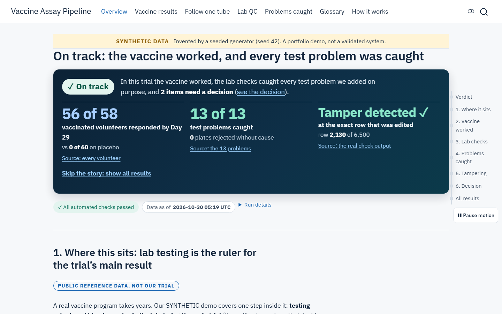 | 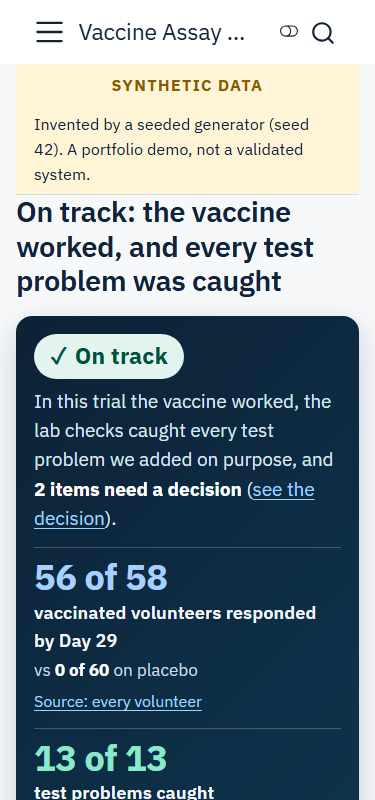 |
| 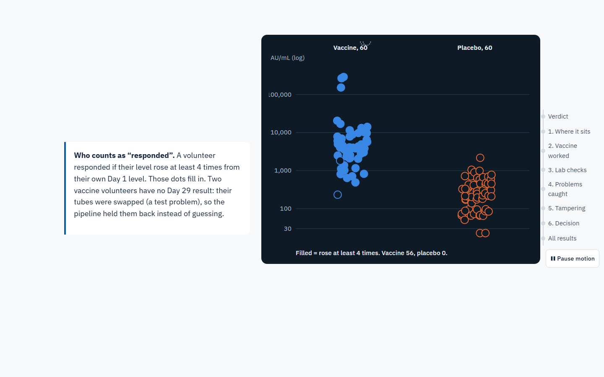 | 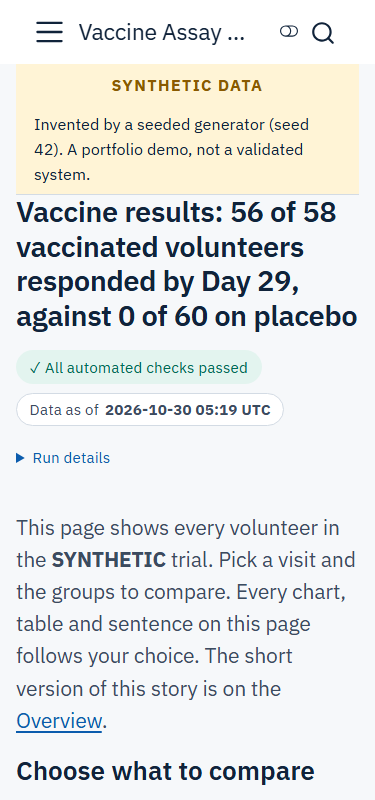 |
| 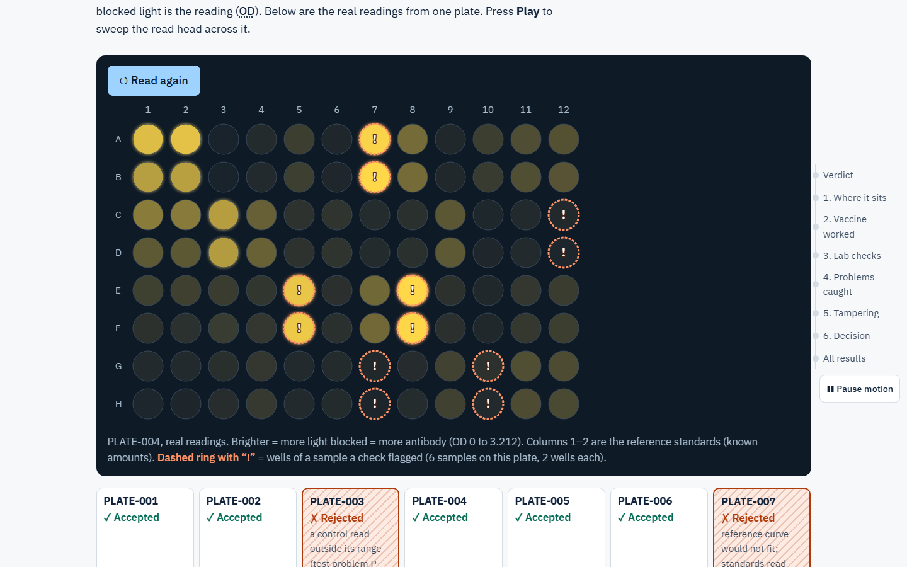 | 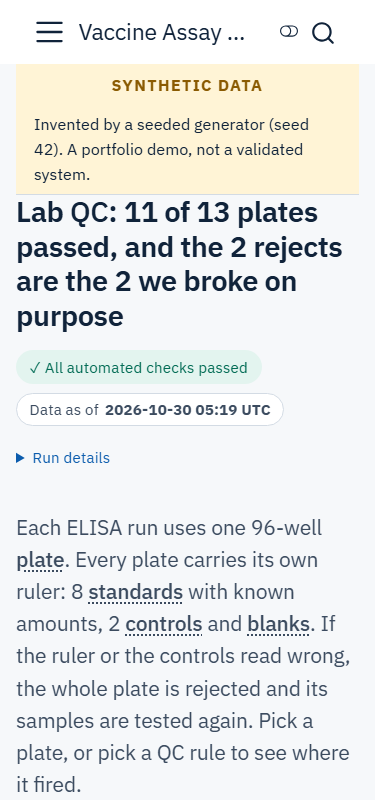 |
| 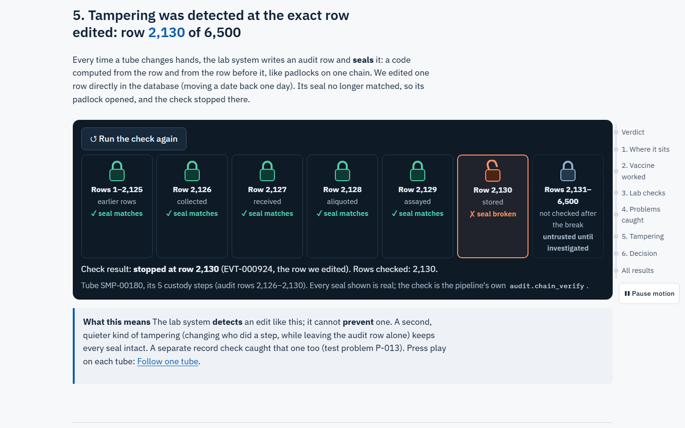 | 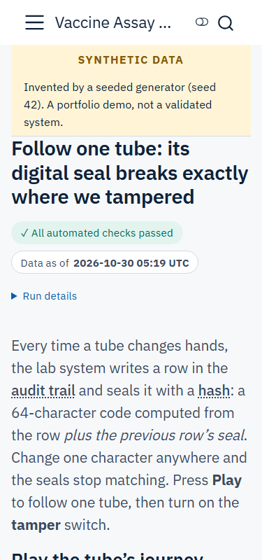 |
| 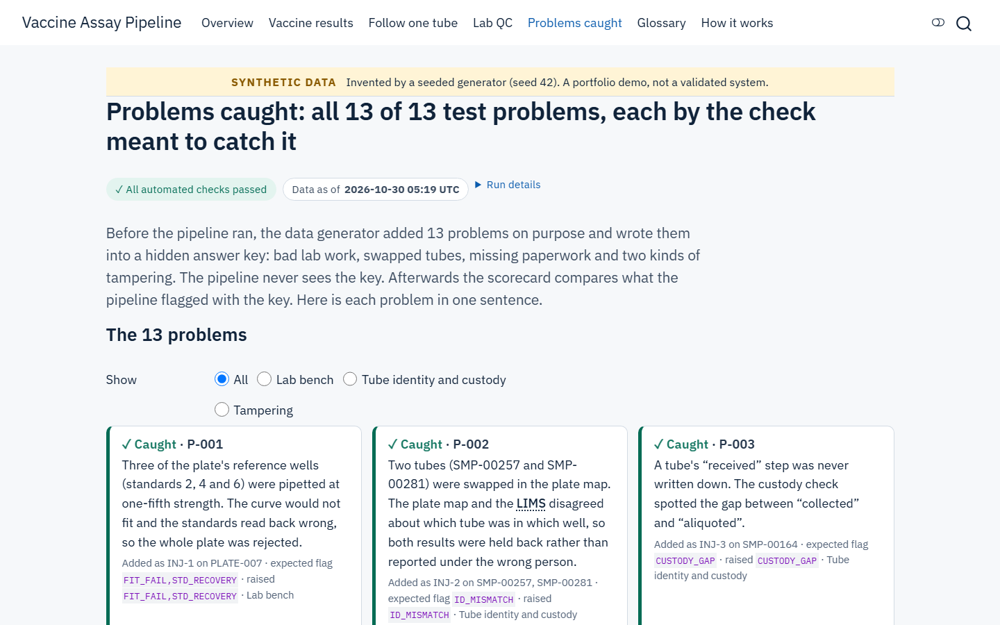 | 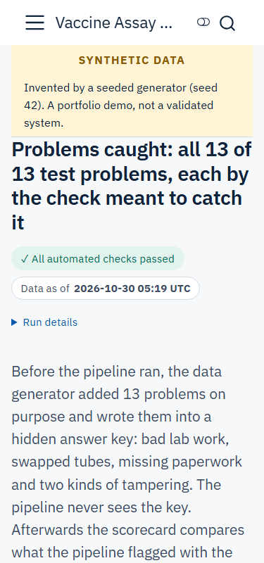 |

More screenshots (glossary, how it works) are in [docs/img/site/](docs/img/site/).

## See it without running it

Charts from the latest local run (`python -m pipeline.run` re-draws the first three;
`python tools/make_showcase_figures.py` re-draws the last three from recorded outputs).

| | |
|---|---|
| 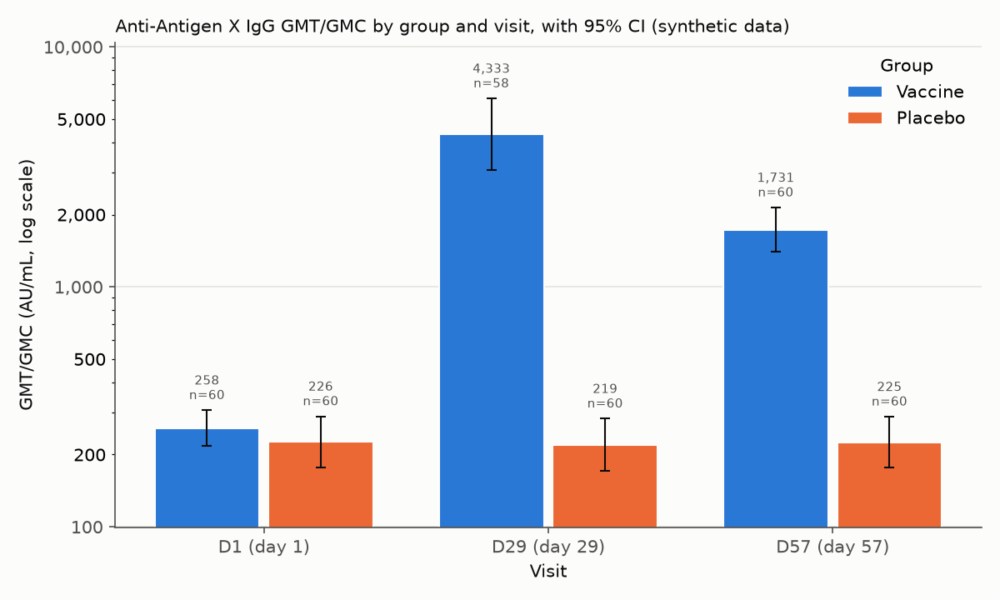 | 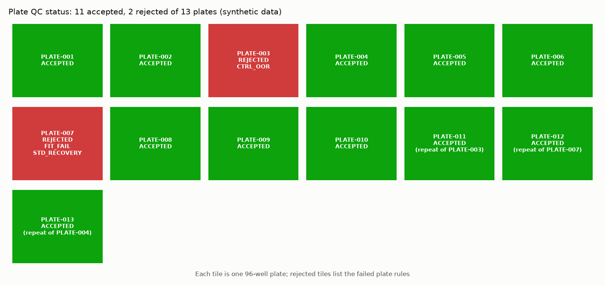 |
| **Immunogenicity.** GMT/GMC by group and visit, log scale, 95% CI. | **Plate QC.** Each tile is a 96-well plate; rejected tiles name the failed rules; repeats name the plate they replace. |
| 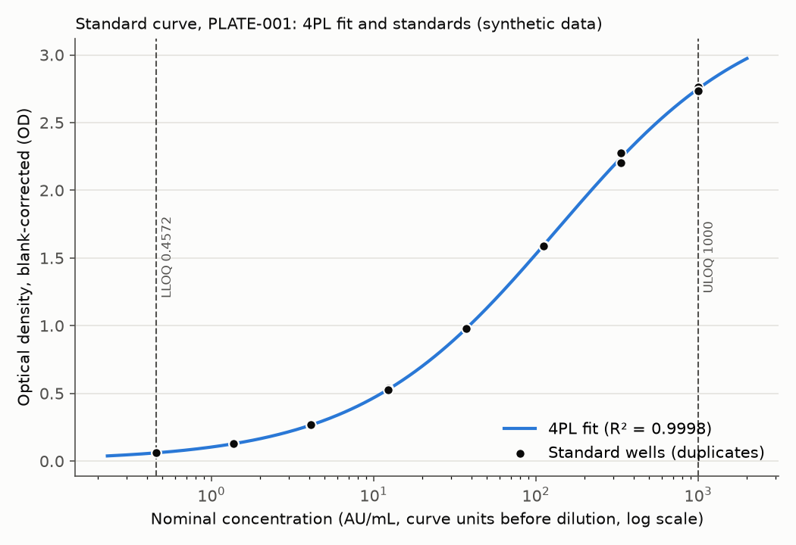 | 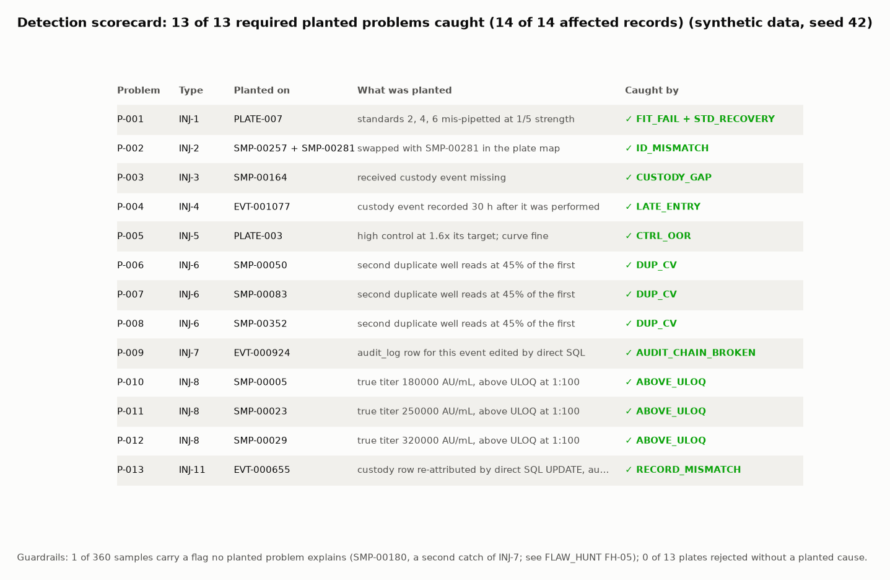 |
| **Standard curve.** 4PL fit with the working range; samples outside it are labelled, never extrapolated. | **Detection scorecard.** Each planted problem and the flag that caught it. |

## Infographics

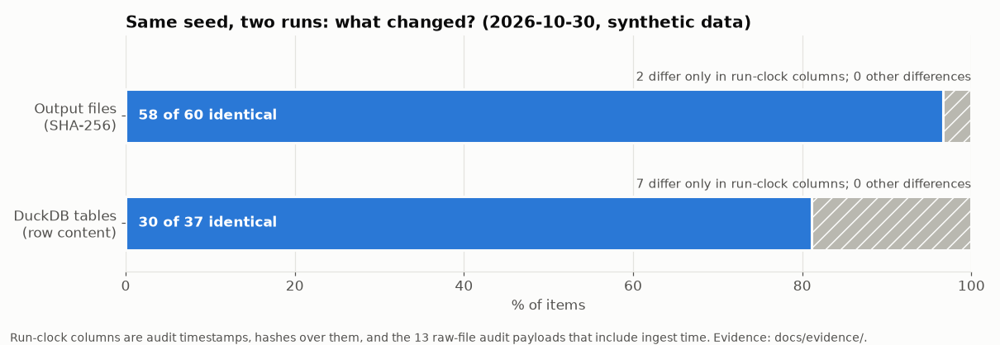

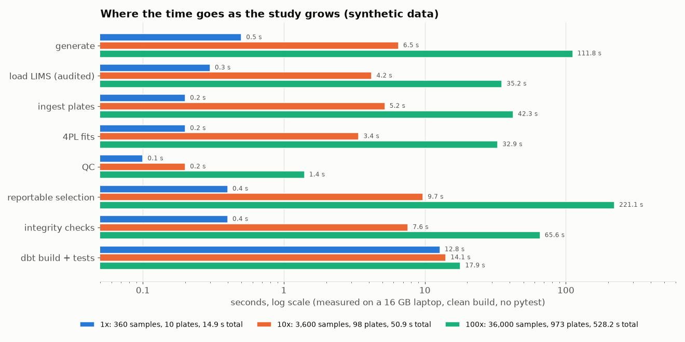

## Before vs after the fix round

The first complete build passed its own tests. Code review and QA then attacked it. What changed:

| Question | First build | Now | Evidence |
|---|---|---|---|
| Is a record edited by direct SQL detected? | **No.** The hash chain watched the audit log, not the records (REVIEW F1) | **Yes.** Reconciliation flags RECORD_MISMATCH; planted as INJ-11 and caught | [ADR 007](docs/team/adr/007-detect-record-edits-reconciliation-and-anchor.md) |
| Is deleting the newest audit rows detected? | **No** (BUG-004) | **Yes**, by checkpoints, plus a read-only anchor file | `tests/test_audit.py::test_tail_truncation_caught_by_checkpoint` |
| Does one `inf` OD cell stop the run? | **Yes**, the whole run aborted (BUG-001) | **No.** That plate is rejected and logged; the run goes on | `tests/qa/test_qa_run_edges.py::test_infinite_od_does_not_abort_run` |
| Can a broken curve make the control check look like it works? | **Yes** (REVIEW F3) | **No.** Masking rule, and a test that expects a miss | `tests/test_scorecard.py::test_inj5_not_detected_without_ctrl_oor` |
| Does a bad `--seed` delete the last run? | **Yes**, it happened (BUG-007) | **No.** Validated before anything is deleted | [Postmortem](docs/POSTMORTEM_2026-10-30_INJ11_harness_drift.md#second-incident-short-form-bug-007-a-bad---seed-deleted-the-previous-run) |
| Does an unparseable plate's samples get re-run? | **No**, they showed as "not assayed" (BUG-003) | **Yes**, on the re-assay list as PLATE_INGEST_ERROR | `tests/qa/test_qa_pipeline_edges.py::test_truncated_plate_samples_on_reassay_list` |

## How it was, and how we fixed it

- **The wrong object was protected.** ADR 001 promised tamper detection through a hash chain. Review showed it
  protected the audit rows, while a realistic fraud edits the record. ADR 007 supersedes that part of ADR 001.
- **A test helper drifted from the pipeline.** QA's staged build had a hand copy of step 7 and stopped planting
  INJ-11. Eight tests failed; one function is now shared. [Postmortem](docs/POSTMORTEM_2026-10-30_INJ11_harness_drift.md).
- **The flaw hunt found three more** ([FLAW_HUNT.md](docs/FLAW_HUNT.md)): a planted bug that removes INJ-11 passes
  all 69 seat-level scorecard, generator, ALCOA and audit tests (only the slow seed sweep catches it: BUG-010); a landing CSV with a dropped
  column loads as NULLs (BUG-011); a KPI row is missing (BUG-012). All three are now fixed, each with a regression
  test ([docs/team/BUGS.md](docs/team/BUGS.md)); the drift probe now rejects all 3 cases.

## Quickstart

About 5 minutes on a laptop: about 4 min to install (measured 4.3 min on a fresh venv), under a minute to build, and about 6 min more if you add the tests.
Needs **Python 3.13** and nothing else: no database server, no API keys, no network calls at runtime.

**Windows (PowerShell)**

```powershell
git clone https://github.com/MichaelH117/vaccine-assay-pipeline.git
cd vaccine-assay-pipeline
py -3.13 -m venv .venv
.venv\Scripts\python -m pip install -r requirements.txt
.venv\Scripts\python -m pipeline.run            # build everything, seed 42
.venv\Scripts\python -m pipeline.run --test     # same, plus the full pytest suite
```

**macOS / Linux**

```bash
git clone https://github.com/MichaelH117/vaccine-assay-pipeline.git
cd vaccine-assay-pipeline
python3.13 -m venv .venv
.venv/bin/python -m pip install -r requirements.txt
.venv/bin/python -m pipeline.run            # build everything, seed 42
.venv/bin/python -m pipeline.run --test     # same, plus the full pytest suite
```

**Expected output** of `python -m pipeline.run` (steps 1/8 to 8/8, then a summary; the time varies):

```text
1/8 generate synthetic study ...
...
8/8 dbt build (staging, integrity, core, marts + tests) ...
{"samples": 360, "plates": 13, "plates_rejected": 2, "reportable": 358, "missing": 2, "reassay_rows": 80, ...
dbt: {'nodes': 145, 'passed': 145, 'warn': 0, 'failed': 0, 'models': 34, 'tests': 111}; tests: ...; done in 12.3 s
```

It writes the database and exports to `data/` (git-ignored), the charts to `docs/img/`, the numbers to
`docs/results.json`, and the results block above. With `--test` the pytest line reads `245 passed`.
Other options: `--seed N` (another synthetic study), `--optional-problems` (also plant INJ-9 and INJ-10).
A fast check without the full build: `python -m pytest tests/test_curve.py tests/test_audit.py -q`.
Lint: `python -m ruff check .`. The same lint and tests run in GitHub Actions ([ci.yml](.github/workflows/ci.yml)).

## Architecture

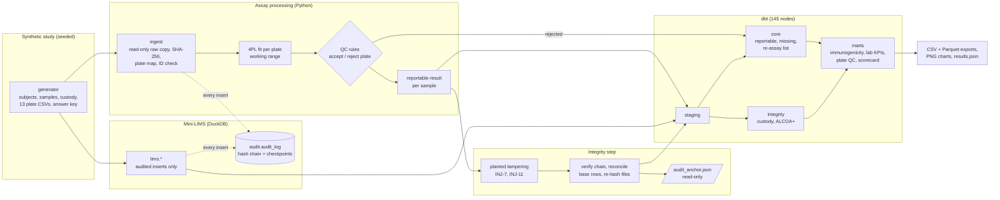

| Layer | What it does | Where |
|---|---|---|
| Generator | Seeded synthetic trial (2 groups x 60 subjects x 3 visits), plates, custody events, 13 planted problems and their answer key | `generator/` |
| Mini-LIMS + audit | Insert-only write API; every insert writes an audit row (who, what, when in UTC, why); hash chain, checkpoints, reconciliation, anchor | `pipeline/audit.py`, `pipeline/integrity.py` |
| Assay | Plate parsing, 4PL fit (`scipy`), QC rules from `config/qc_rules.yaml`, reportable selection | `pipeline/` |
| Transform | dbt-duckdb: staging, integrity, core and marts, 111 data tests | `dbt/` |
| Outputs | CSV and Parquet marts, charts, `docs/results.json`, dashboard spec | `data/marts/`, `docs/` |

Design: [DESIGN.md](docs/team/DESIGN.md) · Decisions: [7 ADRs](docs/team/adr/) · Metrics: [METRICS.md](docs/METRICS.md) ·
Dashboard spec: [DASHBOARD_SPEC.md](docs/DASHBOARD_SPEC.md).

## Checks

| Check | Command | Latest result |
|---|---|---|
| Full run with tests | `python -m pipeline.run --test` | pytest 245 passed, 0 failed; dbt 145 of 145; about 6 min |
| Build only | `python -m pipeline.run` | 10.6-12.3 s on the build laptop |
| Repeat-run check | run twice, `sh tools/hash_outputs.sh run1.sha256` after each, then `diff` | 58 of 60 identical (FLAW_HUNT FH-01) |
| Landing schema drift probe | `PYTHONPATH=. python tools/schema_drift_probe.py` | 3 of 3 drift cases rejected (BUG-011 fixed, re-run 2026-10-30) |
| Scale probe | `PYTHONPATH=. python tools/scale_probe.py 10 <out_dir>` | clean builds: 1x 14.9 s; 10x (3,600 samples) 50.9 s; 100x (36,000 samples, 573,017 audit rows) 528.2 s; dbt 137 of 137 at each (measured before the BUG-011/012 fixes added 8 tests) |
| Lint | `python -m ruff check .` | clean; CI is set up to run ruff + pytest on every push ([ci.yml](.github/workflows/ci.yml)), but has not run on GitHub yet |

## Senior-scope documents

| Document | What it answers |
|---|---|
| [BRIEF.md](docs/BRIEF.md) | Who the user is, the decision, goals and non-goals, the success metric and guardrails |
| [RISK_REGISTER.md](docs/RISK_REGISTER.md) | 14 risks with likelihood, impact, mitigation, owner, status |
| [KNOWN_ISSUES.md](docs/KNOWN_ISSUES.md) | 15 honest limits and what would fix each |
| [FLAW_HUNT.md](docs/FLAW_HUNT.md) | 10 failure modes hunted, each with evidence |
| [POSTMORTEM](docs/POSTMORTEM_2026-10-30_INJ11_harness_drift.md) | A real bug, blameless, with its regression test |
| [SCALE_AND_COST.md](docs/SCALE_AND_COST.md) | Measured 1x, 10x and 100x, where it slows first, cloud cost estimates |
| [OPERATING_MODEL.md](docs/OPERATING_MODEL.md) | Roles, service levels, runbook, change control (proposed) |
| [ROADMAP.md](docs/ROADMAP.md) | Now / next / later, and what we won't do |
| [CASE_STUDY.md](docs/CASE_STUDY.md) · [EXECUTIVE_ONE_PAGER.md](docs/EXECUTIVE_ONE_PAGER.md) | The story, long and short |
| [Validation pack](docs/validation/) | URS, risk assessment, traceability, ALCOA+ checklist, plan, summary (DRAFT v0.2) |
| [Team record](docs/team/) | Spec, design, 7 ADRs, code review, test plan, bugs, handoffs |

## Known limitations

The full list is in [docs/KNOWN_ISSUES.md](docs/KNOWN_ISSUES.md). The top items:
1. **Every run rebuilds from scratch and deletes the previous audit trail.** Right for a reproducible demo; in a
   real lab it would be record destruction. No incremental load yet.
2. **Detection, not prevention.** DuckDB cannot block a direct SQL edit; the pipeline detects it. The anchor file
   lives next to the database, so it protects one run only.
3. **A killed run leaves `data/` half built** while `docs/results.json` still shows the last good run.
4. **No authentication or e-signature;** `performed_by` is supplied by code.
5. **QC thresholds are demo defaults,** not checked against ICH M10.
6. **CI is set up but has not run on GitHub yet** (the repo is local until it is pushed). Dependencies are pinned for
   Python 3.13 only.

## Author

Built by **Michael Hanson** ([GitHub](https://github.com/MichaelH117)) with a team of AI agent seats, each logging
its work in [docs/team/HANDOFF.md](docs/team/HANDOFF.md). All data is synthetic.
